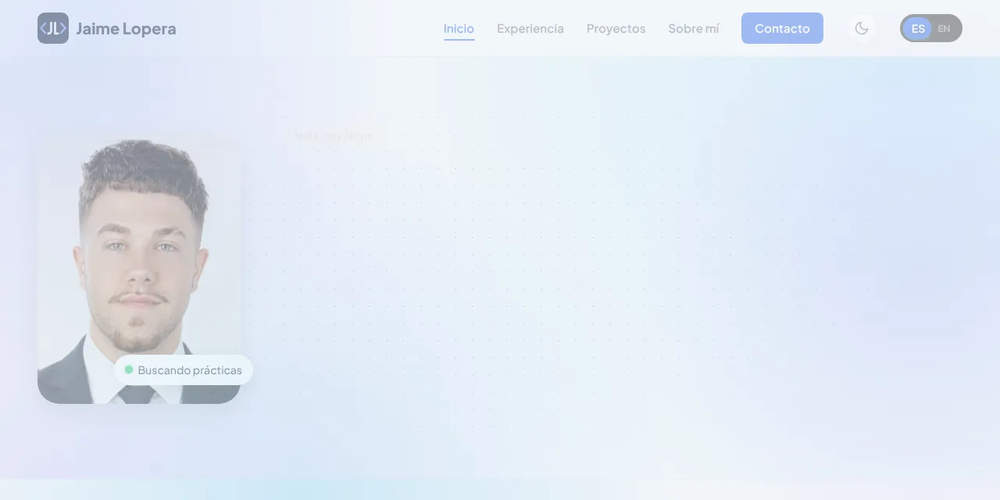

# Portfolio de Jaime Lopera

Web personal de Jaime Lopera Velázquez, estudiante de 2º de Desarrollo de Aplicaciones Web (DAW bilingüe) en Granada. Su objetivo es presentar su perfil y conseguir unas prácticas en desarrollo web.

**Web publicada:** https://jaimelopera.github.io



## Qué incluye

- Seis páginas: inicio, experiencia y formación, proyectos, sobre mí, contacto y política de privacidad, más una página 404 propia.
- Modo claro y oscuro. Respeta la preferencia del sistema y recuerda la elección del usuario.
- Versión en español e inglés. El HTML está en español y `js/idiomas.js` traduce los textos con un diccionario.
- Formulario de contacto conectado a Formspree, con mensajes de éxito y de error.
- Diseño responsive con menú móvil.
- Accesibilidad: foco visible, etiquetas `aria` y respeto a `prefers-reduced-motion`.
- SEO básico: metadatos Open Graph, `sitemap.xml`, `robots.txt` y URL canónica.

## Tecnologías

HTML, CSS y JavaScript sin frameworks ni dependencias. Fuente Plus Jakarta Sans alojada en local. Publicada con GitHub Pages.

## Estructura

```
.
├── index.html, experiencia.html, proyectos.html,
│   sobre-mi.html, contacto.html, privacidad.html, 404.html
├── css/style.css        # estilos, variables y tema claro/oscuro
├── js/
│   ├── main.js          # menú, formulario, animaciones de scroll
│   ├── theme.js         # tema claro/oscuro
│   └── idiomas.js       # traducciones ES / EN
└── resources/           # imágenes, fuentes y CV
```

## Cómo verla en local

No necesita instalación. Desde la carpeta del proyecto:

```bash
python3 -m http.server 8000
```

Y abre http://localhost:8000 en el navegador.

## Detalles técnicos

- **Sin frameworks ni dependencias:** todo el código es HTML, CSS y JavaScript propio.
- **Rendimiento:** imágenes en WebP y fuentes alojadas en local.
- **Animaciones moderadas:** aparición al hacer scroll y pequeñas transiciones, todas desactivadas con `prefers-reduced-motion`.

## Contacto

- LinkedIn: https://www.linkedin.com/in/jaime-lopera-vel%C3%A1zquez/
- GitHub: https://github.com/JaimeLopera
